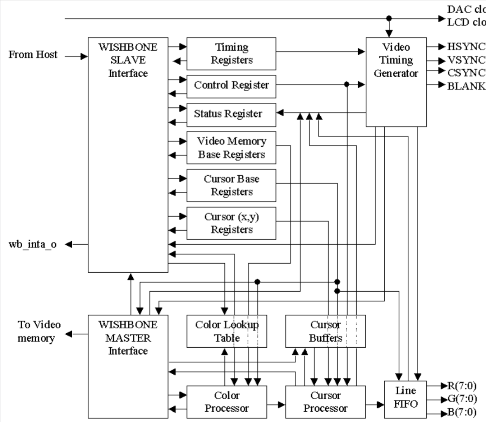

# vga_enh_top Design Specification

## 1. Introduction

`vga_enh_top` is an enhanced VGA/LCD display controller with a WISHBONE slave programming interface and a WISHBONE master fetch interface for video data. The design generates programmable video timing, reads frame data from external memory, converts pixel data to RGB outputs, and optionally supports CLUT-based pseudo-color, bank switching, hardware cursors, and 12-bit DVI-oriented output formatting.

The controller is intended for embedded display pipelines where software configures timing/control registers and then allows autonomous frame fetch and scanout.

## 2. Module Diagram

## 3. Interface

### 3.1 Top-Level Ports

| Signal | Direction | Width | Description |
| --- | --- | --- | --- |
| `wb_clk_i` | Input | 1 | WISHBONE/control clock. |
| `wb_rst_i` | Input | 1 | Active-high synchronous reset in WISHBONE clock domain. |
| `rst_i` | Input | 1 | Asynchronous reset input; effective polarity is parameterized by `ARST_LVL`. |
| `wb_inta_o` | Output | 1 | Interrupt request to host. |
| `wbs_adr_i` | Input | 12 | WISHBONE slave address. Register block uses word addressing (`[11:2]`). |
| `wbs_dat_i` | Input | 32 | WISHBONE slave write data. |
| `wbs_dat_o` | Output | 32 | WISHBONE slave read data. |
| `wbs_sel_i` | Input | 4 | WISHBONE byte enables; core requires full 32-bit accesses (`4'b1111`). |
| `wbs_we_i` | Input | 1 | WISHBONE slave write enable. |
| `wbs_stb_i` | Input | 1 | WISHBONE slave strobe. |
| `wbs_cyc_i` | Input | 1 | WISHBONE slave cycle indicator. |
| `wbs_ack_o` | Output | 1 | WISHBONE slave normal termination acknowledge. |
| `wbs_rty_o` | Output | 1 | WISHBONE retry response (used when control register update is attempted while master is busy). |
| `wbs_err_o` | Output | 1 | WISHBONE error response for unsupported transfer shape. |
| `wbm_adr_o` | Output | 32 | WISHBONE master address for video/cursor memory reads. |
| `wbm_dat_i` | Input | 32 | WISHBONE master read data from memory. |
| `wbm_sel_o` | Output | 4 | WISHBONE master byte enables (always full word). |
| `wbm_we_o` | Output | 1 | WISHBONE master write enable (always read-only operation). |
| `wbm_stb_o` | Output | 1 | WISHBONE master strobe. |
| `wbm_cyc_o` | Output | 1 | WISHBONE master cycle indicator. |
| `wbm_cti_o` | Output | 3 | WISHBONE B3 cycle-type identifier (`classic` / `incrementing burst` / `end-of-burst`). |
| `wbm_bte_o` | Output | 2 | WISHBONE B3 burst type extension (linear burst). |
| `wbm_ack_i` | Input | 1 | WISHBONE master acknowledge input. |
| `wbm_err_i` | Input | 1 | WISHBONE master error input. |
| `clk_p_i` | Input | 1 | Pixel clock input. |
| `dvi_pclk_p_o` | Output | 1 | Optional DVI pixel clock positive output (`VGA_12BIT_DVI`). |
| `dvi_pclk_m_o` | Output | 1 | Optional DVI pixel clock negative output (`VGA_12BIT_DVI`). |
| `dvi_hsync_o` | Output | 1 | Optional DVI horizontal sync (`VGA_12BIT_DVI`). |
| `dvi_vsync_o` | Output | 1 | Optional DVI vertical sync (`VGA_12BIT_DVI`). |
| `dvi_de_o` | Output | 1 | Optional DVI data enable (`VGA_12BIT_DVI`). |
| `dvi_d_o` | Output | 12 | Optional DVI data bus (`VGA_12BIT_DVI`). |
| `clk_p_o` | Output | 1 | Pixel clock output for downstream VGA path. |
| `hsync_pad_o` | Output | 1 | Horizontal synchronization output. |
| `vsync_pad_o` | Output | 1 | Vertical synchronization output. |
| `csync_pad_o` | Output | 1 | Composite synchronization output. |
| `blank_pad_o` | Output | 1 | Blanking output. |
| `r_pad_o` | Output | 8 | Red video component output. |
| `g_pad_o` | Output | 8 | Green video component output. |
| `b_pad_o` | Output | 8 | Blue video component output. |

### 3.2 Slave Address Map

| Offset (`wbs_adr_i`) | Name | Description |
| --- | --- | --- |
| `0x000` | `CTRL` | Control register |
| `0x004` | `STAT` | Status/interrupt-pending register |
| `0x008` | `HTIM` | Horizontal timing fields |
| `0x00C` | `VTIM` | Vertical timing fields |
| `0x010` | `HVLEN` | Horizontal/vertical full lengths |
| `0x014` | `VBARa` | Video memory base address page A |
| `0x018` | `VBARb` | Video memory base address page B |
| `0x030` | `C0XY` | Cursor0 position |
| `0x034` | `C0BAR` | Cursor0 base address |
| `0x040`-`0x05C` | `C0CR` | Cursor0 color registers (if cursor0 is implemented) |
| `0x070` | `C1XY` | Cursor1 position |
| `0x074` | `C1BAR` | Cursor1 base address |
| `0x080`-`0x09C` | `C1CR` | Cursor1 color registers (if cursor1 is implemented) |
| `0x800`-`0xFFC` | `PCLT` | Pseudo-color lookup table memory window |

Reserved offsets return zero on reads and ignore writes.

### 3.3 Key Register Fields

#### `CTRL`
- `VEN`: video enable.
- `VIE`, `HIE`: vertical/horizontal interrupt enables.
- `VBSIE`, `CBSIE`: video-bank/CLUT-bank switch interrupt enables.
- `VBSWE`, `CBSWE`: request video-bank/CLUT-bank switch on frame boundary.
- `VBL`: frame memory burst length selection.
- `CD`: color depth selection (8/16/24/32 bpp).
- `PC`: 8bpp mode selection between grayscale and pseudo-color.
- `HSL`, `VSL`, `CSL`, `BL`: output polarity controls.
- Cursor enable/resolution fields for cursor0/cursor1.
- Implementation extension: `dvi_odf` output formatting control bits are present.

#### `STAT`
- Active page indicators for video memory and CLUT.
- Interrupt pending flags: CLUT switch, video bank switch, horizontal sync, vertical sync, line FIFO underrun, system error.
- Hardware cursor availability flags reflect compile-time cursor implementation.

Pending bits are software-clearable by writing zero to the corresponding status bit position.

#### Timing Registers
- `HTIM`: `Thsync`, `Thgdel`, `Thgate`.
- `VTIM`: `Tvsync`, `Tvgdel`, `Tvgate`.
- `HVLEN`: `Thlen`, `Tvlen`.

## 4. Function Description

### 4.1 Overall Operation

The core operates as a programmable scanout engine:
- software configures control/timing/base-address registers through the WISHBONE slave interface,
- the WISHBONE master fetches frame data from external memory,
- pixel/color processing and optional cursor overlay generate RGB output,
- timing generator emits sync/blanking signals for VGA/LCD output timing.

### 4.2 Programming and Bus Interaction

The slave interface accepts 32-bit aligned full-word accesses. Non-full-word accesses are rejected with slave error signaling. CLUT accesses are routed to internal CLUT memory space; register accesses are routed to control/status/timing banks. If control register writes are attempted while a transfer-in-progress condition is active, retry signaling is generated.

### 4.3 Timing Generation

Programmable horizontal and vertical timing fields define sync pulse widths, gate delays, visible gate widths, and full line/frame lengths. The logical visible region is determined by horizontal and vertical gate intervals. Sync and blank outputs are polarity-adjusted per control bits.

Horizontal and vertical event strobes are generated and forwarded to the slave domain for interrupt-pending state updates.

### 4.4 Frame Fetch and Buffering

The master interface continuously reads frame data into an internal FIFO structure while video is enabled. Burst length is configurable and used to determine transaction grouping. The read path is designed to keep the fetch FIFO above a low-water condition so downstream color conversion can continue feeding pixel output.

A dual-clock line FIFO bridges from WISHBONE clock domain to pixel clock domain. If pixel-domain read demand occurs while the line FIFO is empty, line-underrun interrupt pending is asserted.

### 4.5 Color Processing

Color processing supports:
- 32bpp and 24bpp direct-color extraction,
- 16bpp packed color expansion,
- 8bpp grayscale,
- 8bpp pseudo-color via internal CLUT.

CLUT space contains two banks. Active bank selection is tracked in status and can switch on frame boundary when CLUT bank-switch request is enabled.

### 4.6 Video and CLUT Bank Switching

Two video base registers support ping-pong buffering. When video bank switching is requested and frame completion is reached, active video page toggles and a bank-switch pending interrupt can be generated. The switch-request control bit auto-clears after switch action.

CLUT bank switching follows the same frame-boundary concept using two CLUT pages and corresponding pending interrupt signaling.

### 4.7 Hardware Cursor Operation

The architecture supports up to two optional hardware cursors (compile-time selectable):
- each cursor has programmable position and memory base address,
- cursor pattern data is fetched by the master path and loaded into local cursor buffer memory,
- cursor overlay is applied in the pixel pipeline after base color processing,
- cursor0 has higher reload priority when both cursors request reload at the same boundary.

Cursor resolution supports 32x32 and 64x64 modes with associated color interpretation behavior.

### 4.8 Interrupt Behavior

`wb_inta_o` is asserted when any enabled maskable interrupt source is pending, or when non-maskable error sources are pending:
- horizontal sync pending,
- vertical sync pending,
- video bank switch pending,
- CLUT switch pending,
- line FIFO underrun pending,
- system error pending.

System error pending is raised when master bus error is observed during frame/cursor memory read activity.

## 5. Implementation Details

### 5.1 Clock Domains and Reset

- `wb_clk_i` domain: register control, status/interrupt accumulation, memory master sequencing.
- `clk_p_i` domain: timing generator output cadence and final RGB/sync output updates.
- `vga_fifo_dc` provides explicit dual-clock buffering with synchronized clear behavior between domains.

Asynchronous reset input is polarity-programmable via `ARST_LVL`; synchronous reset is also supported via `wb_rst_i`.

### 5.2 Wishbone Slave Block (`vga_wb_slave`)

The slave block implements register decode, CLUT/register access routing, and response generation:
- `ack` for valid accesses,
- `rty` on specific busy-control write condition,
- `err` on non-32-bit transfer shape.

It also aggregates interrupt inputs into `STAT` pending bits and combines pending/enable terms for `inta_o`.

### 5.3 Wishbone Master Block (`vga_wb_master`)

The master block arbitrates frame fetch and cursor pattern reload reads:
- generates linear incrementing burst cycles,
- tracks image completion from programmed visible dimensions,
- toggles active video page when enabled switch conditions are met,
- captures read data in FIFO for downstream color processing,
- reports system error on bus-error input.

Master cycles are read-only, with full-word select lines.

### 5.4 Pixel Generator Block (`vga_pgen`)

`vga_pgen` integrates timing generation, color conversion path, optional cursor overlay stages, and output formatting:
- consumes fetched frame data,
- performs CLUT requests and pseudo-color translation when selected,
- overlays cursor color/alpha behavior when cursor processors are enabled,
- emits RGB and sync/blank outputs,
- optionally emits 12-bit DVI-formatted outputs under compile-time enable.

### 5.5 CLUT and Shared Memory Arbitration

`vga_csm_pb` arbitrates CLUT memory access between internal pixel processing and external host access. The shared-memory interface returns host and internal read data from one physical memory and serializes concurrent requests with defined acknowledge behavior.

## 6. Submodule List

### 6.1 `vga_wb_slave`

Role: Slave-side register/CLUT access interface, register bank implementation, and interrupt/status control.

| Signal Group | Description |
| --- | --- |
| WISHBONE slave (`adr_i`, `dat_i/o`, `sel_i`, `we_i`, `stb_i`, `cyc_i`, `ack_o`, `rty_o`, `err_o`) | Host control/status/config interface. |
| Control outputs (`ven`, timing/polarity/color mode fields, bank-switch controls) | Drive master/pixel pipeline behavior. |
| Status/interrupt inputs (`hint_in`, `vint_in`, `vbsint_in`, `cbsint_in`, `luint_in`, `sint_in`) | Latched to pending flags and interrupt output. |

### 6.2 `vga_wb_master`

Role: External memory read engine for frame and cursor data.

| Signal Group | Description |
| --- | --- |
| WISHBONE master (`cyc_o`, `stb_o`, `cti_o`, `bte_o`, `we_o`, `adr_o`, `sel_o`, `ack_i`, `err_i`, `dat_i`) | Burst read transactions to video/cursor memory. |
| Video control inputs (`ctrl_ven`, `ctrl_cd`, `ctrl_vbl`, `ctrl_vbsw`, base addresses, timing gate widths) | Define fetch size, bursting, and page selection behavior. |
| FIFO interface (`fb_data_fifo_*`) | Outputs fetched words toward color processor. |

### 6.3 `vga_pgen`

Role: Pixel/timing generation, color conversion, cursor composition, and output formatting.

| Signal Group | Description |
| --- | --- |
| Timing control inputs (`Th*`, `Tv*`, polarity bits) | Drive sync/blank generation and visible-region control. |
| Pixel data path (`fb_data_fifo_*`, `clut_*`, cursor controls, line FIFO ports) | Converts fetched data into RGB stream with optional CLUT/cursor processing. |
| Video outputs (`hsync_o`, `vsync_o`, `csync_o`, `blank_o`, `r_o`, `g_o`, `b_o`, optional DVI) | Final display interface signals. |

### 6.4 `vga_csm_pb`

Role: Shared single-port memory arbiter used for CLUT access by two requesters (internal pixel path and external host).

| Port Set | Description |
| --- | --- |
| Requestor 0 (`req0_i`, `ack0_o`, `adr0_i`, `dat0_i/o`, `we0_i`) | Internal path access. |
| Requestor 1 (`req1_i`, `ack1_o`, `adr1_i`, `dat1_i/o`, `we1_i`) | External host path access. |

### 6.5 `vga_fifo_dc`

Role: Dual-clock FIFO bridging WISHBONE and pixel clock domains.

| Port Set | Description |
| --- | --- |
| Write-domain (`wclk`, `wclr`, `wreq`, `d`) | WISHBONE-side RGB line data production. |
| Read-domain (`rclk`, `rclr`, `rreq`, `q`) | Pixel-side consumption. |
| Status (`empty`, `full`) | Domain-synchronous empty/full flags. |

## 7. Clock and Reset

- `wb_clk_i` is the bus/register/master clock domain.
- `clk_p_i` is the pixel/timing/output clock domain.
- `wb_rst_i` provides synchronous reset behavior.
- `rst_i` provides asynchronous reset behavior with effective level selected by `ARST_LVL`.

For reliable startup, reset should be held until clocks are stable, then maintained long enough for internal state initialization before enabling video operation.

## 8. Constraints

- Slave interface supports 32-bit accesses; software should use full byte enables for register/CLUT transactions.
- Reserved register addresses must not be relied upon for function; writes are ignored and reads return zero.
- Video memory and CLUT bank switching should be requested only after software has completed updates to the inactive bank/page.
- Video base address alignment must satisfy burst-length requirements so burst accesses remain aligned.
- Horizontal gate length must be configured to be compatible with selected color depth and bursting constraints.
- `clk_p_i` and `wb_clk_i` must be provisioned such that fetch bandwidth sustains programmed resolution, refresh, and color depth.
- DVI outputs are present only when `VGA_12BIT_DVI` is enabled.
- Cursor0 and cursor1 logic are present only when `VGA_HWC0` and `VGA_HWC1` are enabled, respectively.
