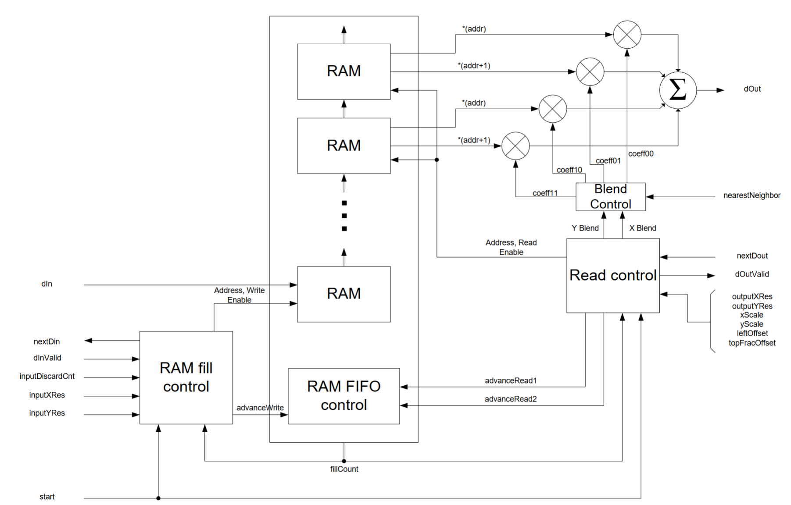

# streamScaler Design Specification

## 1. Introduction

`streamScaler` is a streaming video resizer that supports bilinear interpolation and nearest-neighbor scaling. The module operates frame-by-frame with runtime-configurable input/output resolutions, scaling factors, and sampling offsets.

The design accepts raster-ordered input pixels through an input handshake, buffers selected source lines in internal RAM-based FIFO storage, and produces a resized output stream through an output handshake.

## 2. Module Diagram

## 3. Interface

### 3.1 Top-Level Ports

| Signal | Direction | Width | Description |
| --- | --- | --- | --- |
| `clk` | Input | 1 | Main processing clock for input control, buffer control, interpolation, and output control. |
| `rst` | Input | 1 | Active-high asynchronous reset for control and datapath state. |
| `dIn` | Input | `[DATA_WIDTH*CHANNELS-1:0]` | Input pixel bus. For multi-channel input, channel samples are concatenated on this bus. |
| `dInValid` | Input | 1 | Input data-valid qualifier. |
| `nextDin` | Output | 1 | Input ready signal. A sample is accepted when `dInValid` and `nextDin` are both high. |
| `start` | Input | 1 | Frame-start control pulse. Reinitializes frame-local scaler state for a new frame. |
| `dOut` | Output | `[DATA_WIDTH*CHANNELS-1:0]` | Resized output pixel bus. Channel order matches `dIn`. |
| `dOutValid` | Output | 1 | Output data-valid qualifier. |
| `nextDout` | Input | 1 | Downstream consume request. Output progression occurs when `nextDout` is high and readout is active. |
| `inputDiscardCnt` | Input | `[DISCARD_CNT_WIDTH-1:0]` | Number of initial input pixels to discard before active frame processing. |
| `inputXRes` | Input | `[INPUT_X_RES_WIDTH-1:0]` | Input active width encoded as `(pixels_per_line - 1)`. |
| `inputYRes` | Input | `[INPUT_Y_RES_WIDTH-1:0]` | Input active height encoded as `(lines_per_frame - 1)`. |
| `outputXRes` | Input | `[OUTPUT_X_RES_WIDTH-1:0]` | Output active width encoded as `(pixels_per_line - 1)`. |
| `outputYRes` | Input | `[OUTPUT_Y_RES_WIDTH-1:0]` | Output active height encoded as `(lines_per_frame - 1)`. |
| `xScale` | Input | `[SCALE_BITS-1:0]` | Horizontal source-coordinate step in Q`SCALE_INT_BITS`.`SCALE_FRAC_BITS` format. |
| `yScale` | Input | `[SCALE_BITS-1:0]` | Vertical source-coordinate step in Q`SCALE_INT_BITS`.`SCALE_FRAC_BITS` format. |
| `leftOffset` | Input | `[OUTPUT_X_RES_WIDTH-1+SCALE_FRAC_BITS:0]` | Horizontal source sampling offset in fixed-point format. |
| `topFracOffset` | Input | `[SCALE_FRAC_BITS-1:0]` | Vertical fractional sampling offset in Q0.`SCALE_FRAC_BITS` format. |
| `nearestNeighbor` | Input | 1 | Resize mode select: `0` = bilinear interpolation, `1` = nearest-neighbor selection. |

### 3.2 Stream Handshake Semantics

- Input data is consumed only when `dInValid=1` and `nextDin=1`.
- `nextDin` is deasserted when internal line-buffer fill reaches the configured capacity limit.
- Output progression occurs on cycles where `nextDout=1` and read control is in active output state.
- `dOut` must be sampled only when `dOutValid=1`.

### 3.3 Control Signal Usage Window

Control inputs define scaling and coordinate mapping for a frame. They are intended to be configured between frames and held stable while a frame is processed.

## 4. Function Description

### 4.1 Frame Lifecycle

A frame begins when `start` is asserted for at least one clock cycle. This reinitializes read/write frame state and prepares line-buffer management for new input data. After `start` is deasserted, the module accepts raster-ordered input samples, fills internal line buffers, and begins output generation when buffered source data is sufficient.

### 4.2 Input Path and Source-Line Selection

Write-side control performs the following functions:
- optional initial input discard based on `inputDiscardCnt`,
- tracking of input pixel and line position,
- selection of which incoming lines are written into line storage.

The line-selection logic determines required source lines from current output-line progression and vertical scaling. Lines required for current or adjacent vertical sampling are stored; lines not required for output generation are skipped. This preserves interpolation correctness while reducing unnecessary buffering.

When the configured final input line has been processed, write control enters its completion state and stops requesting additional input data.

### 4.3 Buffered Source Data Organization

Internal `ramFifo` storage provides one write path for selected lines and read access to the four-sample neighborhood required for interpolation. For a selected read address, the module reads both `x` and `x+1` positions from two adjacent source lines, producing:
- top-left sample,
- top-right sample,
- bottom-left sample,
- bottom-right sample.

### 4.4 Output Read Control and Coordinate Progression

Read control tracks output coordinates and fixed-point source coordinates (`xScaleAmount`, `yScaleAmount`). Horizontal progression updates source x-position each output pixel. Vertical progression updates source line selection each output line and may request one-line or two-line advancement in buffered source data (`advanceRead1`, `advanceRead2`) depending on scale step and accumulated position.

At output line boundaries, read control applies a one-cycle output suppression (`lineSwitchOutputDisable`) to align RAM-bank switching and sample selection. If downstream backpressure is already active (`nextDout=0`), this suppression does not introduce additional visible output advancement.

### 4.5 Interpolation Modes

Blend fractions (`xBlend`, `yBlend`) are derived from fractional source coordinates.

- In bilinear mode (`nearestNeighbor=0`), four interpolation coefficients are generated from the blend fractions, four source samples are weighted, and the weighted sum is normalized to the output data width.
- In nearest-neighbor mode (`nearestNeighbor=1`), coefficient selection resolves to a single nearest sample based on blend-half decisions, and output reflects that selected sample.

### 4.6 Multi-Channel Operation

The interpolation datapath is replicated per channel. Each channel slice is processed independently with shared coordinate/control timing, and channel results are concatenated to form `dOut`.

### 4.7 Output Valid Behavior

`dOutValid` is generated from read-control validity through a control pipeline that aligns valid timing with datapath latency. The valid path introduces four clock cycles from internal qualified readout request to asserted `dOutValid`.

## 5. Implementation Details

### 5.1 Control Structure

The design uses separate read-control and write-control state machines.

- Read control waits for sufficient buffered data after frame start, then drives output-coordinate progression and buffered-line advancement.
- Write control manages startup, discard, active-write, and completion phases, and gates `nextDin` according to buffer status and write enable conditions.
- Coordination between read and write sides is based on buffer fill and completion conditions (`fillCount`, `readyForRead`, `allDataWritten`).

### 5.2 Fixed-Point and Blending Datapath

- Scale and offset values are represented in fixed-point formats parameterized by `SCALE_INT_BITS`, `SCALE_FRAC_BITS`, and `FRACTION_BITS`.
- Integer portions of source coordinates select RAM addresses/lines.
- Fractional portions determine interpolation weights.
- Coefficients and sample products are combined in a per-channel multiply-accumulate datapath and normalized before output packing.

### 5.3 Buffer Fill and Backpressure

`nextDin` is asserted only when buffer fill is below the configured line depth and write-side acceptance is active. This provides upstream flow control and prevents line-buffer overflow.

### 5.4 `ramFifo` Read/Write Coupling

`ramFifo` uses rotating line-bank selection for reads and writes and explicit fill-count tracking. Concurrent combinations of write advancement, one-line read advancement, and two-line read advancement update fill state deterministically so that read-side neighborhood access remains consistent under normal configured operation.

## 6. Submodule List

### 6.1 `ramFifo`

Role: Multi-bank line FIFO for source-line storage and four-neighbor sample delivery to interpolation logic.

| Signal | Direction | Width | Description |
| --- | --- | --- | --- |
| `clk` | Input | 1 | FIFO clock (same domain as top module). |
| `rst` | Input | 1 | Active-high reset. |
| `advanceRead1` | Input | 1 | Advance read-line selection by one source line. |
| `advanceRead2` | Input | 1 | Advance read-line selection by two source lines. |
| `advanceWrite` | Input | 1 | Advance write-line selection to next storage bank. |
| `forceRead` | Input | 1 | Enables readout-completion behavior after input writing finishes. |
| `writeData` | Input | `[DATA_WIDTH-1:0]` | Input sample to the selected write line. |
| `writeAddress` | Input | `[ADDRESS_WIDTH-1:0]` | X address within the selected write line. |
| `writeEnable` | Input | 1 | Write strobe for `writeData`/`writeAddress`. |
| `fillCount` | Output | `[BUFFER_SIZE_WIDTH-1:0]` | Number of buffered line slots currently occupied. |
| `readData00` | Output | `[DATA_WIDTH-1:0]` | Current line sample at `readAddress`. |
| `readData01` | Output | `[DATA_WIDTH-1:0]` | Current line sample at `readAddress + 1`. |
| `readData10` | Output | `[DATA_WIDTH-1:0]` | Adjacent line sample at `readAddress`. |
| `readData11` | Output | `[DATA_WIDTH-1:0]` | Adjacent line sample at `readAddress + 1`. |
| `readAddress` | Input | `[ADDRESS_WIDTH-1:0]` | Base X read address for interpolation neighborhood. |

### 6.2 `ramDualPort`

Role: Synchronous dual-port RAM primitive instantiated by `ramFifo` line banks.

| Signal Group | Description |
| --- | --- |
| Port A (`addrA`, `dataA`, `weA`, `qA`) | Write-line path and read path at base address. |
| Port B (`addrB`, `dataB`, `weB`, `qB`) | Read path at adjacent address (`x+1`) and optional write support in primitive interface. |

## 7. Clock and Reset

- `clk` is the single processing clock for control, buffering, and interpolation datapath logic.
- `rst` is active high and asynchronously resets internal state.
- `start` is a frame reinitialization control and must be asserted at each frame boundary.

## 8. Constraints

- The module has no memory-mapped register interface; all configuration is driven by top-level control signals.
- Control inputs should remain stable during active frame processing (from frame start through completion of the corresponding output stream).
- Input samples are expected in raster order (left-to-right, top-to-bottom).
- `inputXRes`, `inputYRes`, `outputXRes`, and `outputYRes` are encoded as resolution minus one.
- `dOut` is meaningful only when `dOutValid=1`.
- `BUFFER_SIZE` must be configured so required neighboring source lines are available when read control advances.
